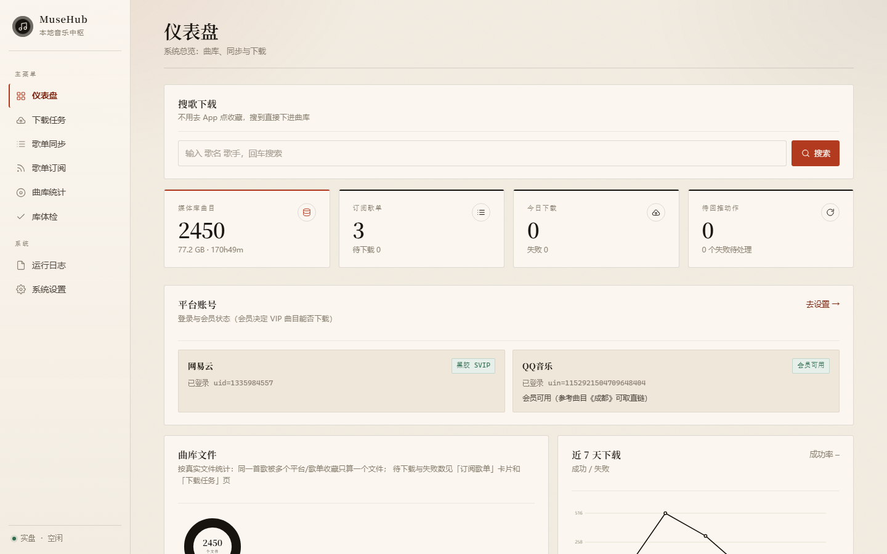
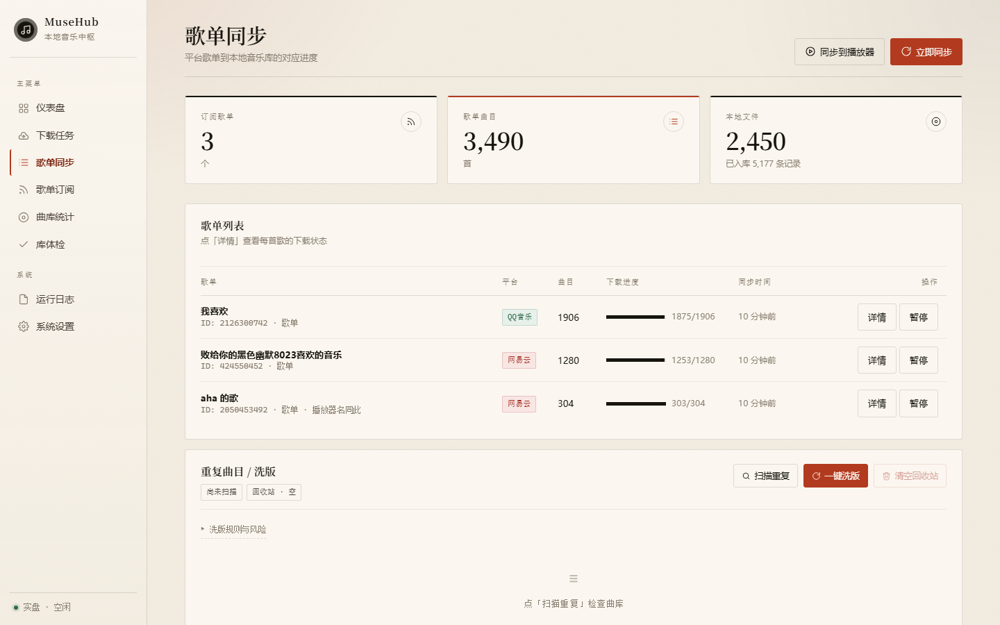
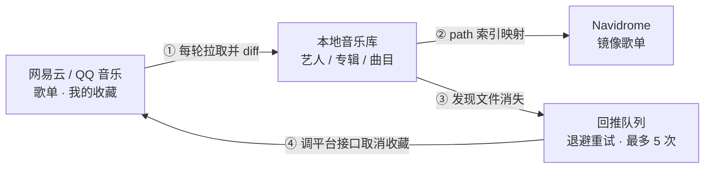
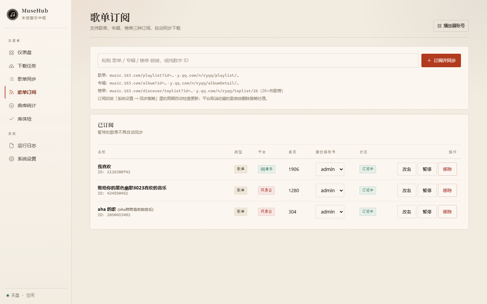
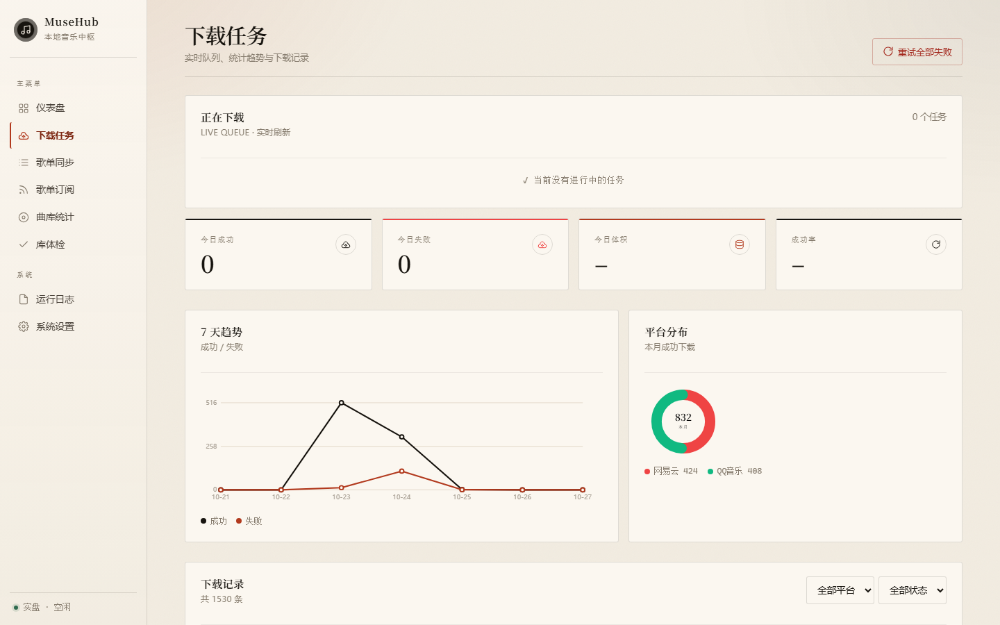
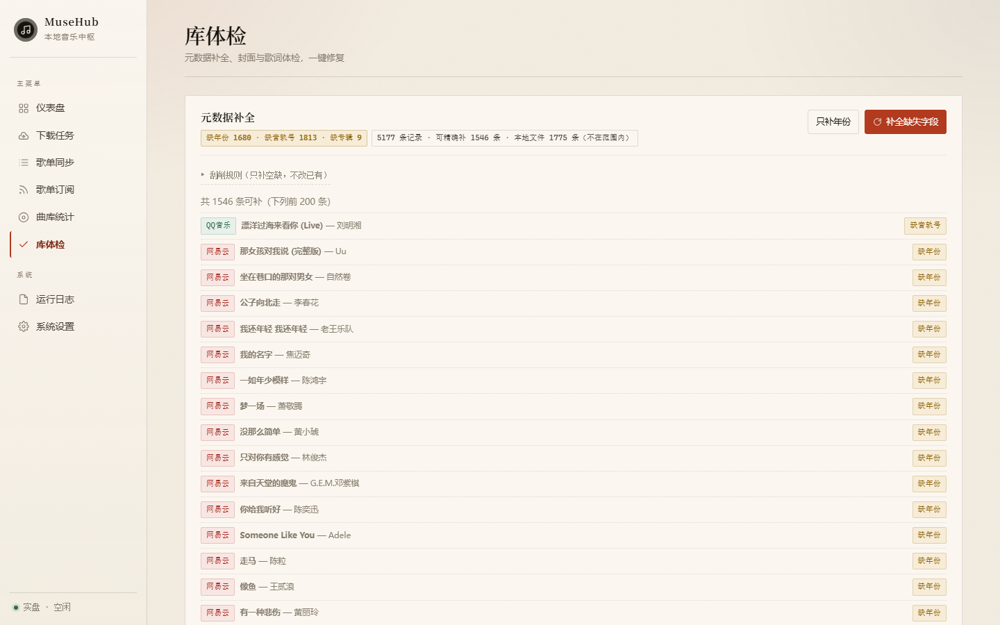
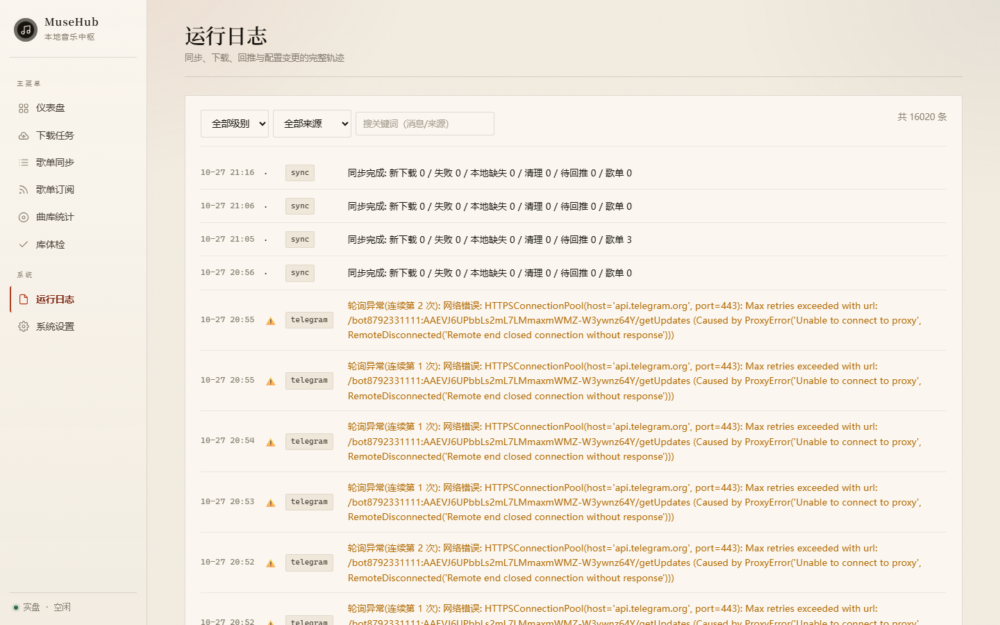

# MuseHub

<p align="center">
  
</p>

<p align="center">
  <b>你在手机上取消一次收藏，本地文件就该消失，播放器歌单也该跟着少一首。</b>
</p>

MuseHub 不是一个"下载器"，它是一台**同步器**：把网易云 / QQ 音乐的歌单，
变成你 NAS 上一份真实、干净、带封面和歌词的音乐库，再镜像成 Navidrome 歌单。
平台、文件、播放器、收藏——四方任何一边的变化，下一轮都会自动对齐。

---

## 核心：双向同步

绝大多数"音乐下载器"只做单向：平台有歌 → 我下载。可真实使用里，动作是**双向**的，
而且最难的不是下载，是**判断"什么才算删"**。

<p align="center">
  
</p>



**① 平台 → 本地。** 每轮（默认 60 分钟）拉一次订阅歌单，和库里逐首比对：
新出现的进下载队列，从歌单里消失的按删除策略处理。不需要你点"同步"，它一直在 diff。

**② 本地 → 播放器。** 把本地路径映射成 Navidrome 的歌曲 ID，按歌单内容做**增量**镜像 ——
不重建歌单，歌单 ID 不变，你在播放器里收藏/排序不会因为一次同步而丢掉。

**③ 本地 → 平台（这是最关键的一段）。** 你在文件管理器里删掉一首歌，下一轮扫描会察觉，
然后**去平台上把这首歌取消收藏**。删文件 = 取消收藏。

这一步听着简单，坑在"文件不见了"其实有三种可能：**移动、改名、真删**。
如果一律当成删除，你用打标签工具整理一次目录，就会把几百首歌的收藏全推掉。
所以 MuseHub 先按文件名在库里找唯一匹配的新路径：命中 → 判定为移动，跟随路径；
只有确认真的没了，才进回推队列。

**④ 回推队列是"可靠"的，不是"尽力"的。** 失败按退避重试，最多 5 次；
平台明确不支持的（比如 QQ 某些账号的写接口），转成「待人工」并留原因，
既不会无限重试刷爆接口，也不会静默把动作吞掉。

### 一轮同步之后会发生什么

| 你做的事 | 下一轮（≤60 分钟）系统会 |
|---|---|
| 手机上收藏一首新歌 | 下载 → 写标签 → 嵌封面 → 归档 → 出现在播放器歌单 |
| 手机上取消收藏 | 若无其他歌单引用 → 文件进回收站 → 播放器歌单里少一首 |
| 在文件管理器里删掉文件 | 平台取消收藏 → 播放器镜像同步移除 |
| 用打标签工具把文件移到别的目录 | 识别为"移动"，跟随新路径，**不会**误推取消收藏 |
| 在播放器里手动改这个歌单 | 下一轮以本地为准校正回来（这就是"镜像"的意思） |
| 平台歌单被误删 | 本地文件按策略保留，不会因为平台少了一首歌就删你的库存 |

最后一条是设计取舍：**本地文件是唯一事实源**。平台挂了、歌单被删了，
你的库还在；反过来本地误删，平台会被取消收藏，但你再收藏回来，下一轮又下回来。
误操作永远有第二次机会，因为每一轮都在自愈。

---

## 还做对了这些事

**下载即归档，不脏你的库。** 命名模板、标签写入、封面嵌入、内嵌歌词 + `.lrc` 落地，
全部在下载完成那一刻做完。播放器里不会出现"未知艺术家"和一堆单曲专辑。

**一次订阅，多个平台多个账号。** 网易云和 QQ 的歌单、专辑、榜单都能粘链接订阅；
同一平台可以配多个账号（`昵称=Cookie`），各下各的。

**播放器歌单可以按人分发。** Navidrome 的私有歌单只有创建者看得见 ——
于是把歌单镜像到不同账号名下，就成了"不同用户看不同歌单"。歌单还能改显示名。

**库体检，而且只补空缺。** 缺封面、缺歌词、重复文件、缺年份/音轨号/专辑，一键补齐。
补元数据走库里记录的平台 ID **精确匹配**，不做"标题+艺人"的模糊搜索，
所以不会把《突然好想你》的现场版配成录音室版。**已有的值永远不会被覆盖。**

**每一步都可查。** 实时下载队列、失败原因（无音源 / 版权限制 / Cookie 失效）、
7 天趋势、可筛选的日志。出问题不用猜。

<table>
<tr>
<td width="50%"></td>
<td width="50%"></td>
</tr>
<tr>
<td></td>
<td></td>
</tr>
</table>

---

## 部署

### 前提

MuseHub 和 Navidrome 必须**挂载同一个音乐目录**。这是镜像能对上文件的前提 ——
MuseHub 写进去的文件，Navidrome 得能扫到。

### 方式一：Docker Compose（推荐）

```bash
git clone <this-repo> musehub && cd musehub
cp .env.example .env
vi .env          # 至少填 3 项：平台账号、NAVIDROME_URL、MUSIC_DIR_HOST
docker compose up -d
```

`docker-compose.yml` 关键部分：

```yaml
services:
  musehub:
    build: .
    container_name: musehub
    restart: unless-stopped
    ports:
      - "8080:8080"                        # 面板端口，冲突就改左边
    env_file: .env
    environment:
      - TZ=Asia/Shanghai
      - DATA_DIR=/data                     # 容器内固定
      - MUSIC_DIR=/music                   # 容器内固定
    volumes:
      - ./data:/data                       # 数据库 / 日志 / 下载暂存
      - ${MUSIC_DIR_HOST:-./music}:/music  # 音乐库，与 Navidrome 同一目录
    healthcheck:
      test: ["CMD", "python", "-c", "import urllib.request as u;u.urlopen('http://127.0.0.1:8080/healthz', timeout=5)"]
      interval: 60s
```

`.env` 里最小可用配置：

```ini
# 平台账号：每行一个「昵称=Cookie」，只填一行就是单账号
NETEASE_ACCOUNTS=默认=MUSIC_U=xxxx; __csrf=yyyy
QQ_ACCOUNTS=默认=uin=o123456789; qm_keyst=xxxx

# 播放器镜像（不填就只下载整理，不动播放器）
NAVIDROME_URL=http://192.168.1.10:4533
NAVIDROME_USERNAME=admin
NAVIDROME_PASSWORD=your-password

# 宿主机上的音乐库路径（compose 靠它挂载）
MUSIC_DIR_HOST=/volume1/music

# 同步节奏
SYNC_INTERVAL_MINUTES=60
DELETE_POLICY=managed_only     # 只删自己下过的，且先进回收站
DRY_RUN=false
```

QQ 音乐还需要一个 `QQ_FAVORITE_DISSID`（『我喜欢』歌单的数字 ID，接口不返回，填一次即可）。

**启动后四步验收**（CLI 和面板等价）：

```bash
docker exec musehub python -m app doctor      # ① 配置体检
docker exec musehub python -m app selftest    # ② 平台连通性：搜索 / 音源 / Navidrome
docker exec musehub python -m app sync --dry  # ③ 试运行：只打印"将要做什么"
docker exec musehub python -m app sync        # ④ 确认无误后真跑一次
```

面板默认在 `http://<host>:8080`，首次进入用 `.env` 里的 `WEB_PASSWORD` 登录。

如果你还没有 Navidrome，`docker-compose.yml` 底部有一份注释好的配置，
取消注释就能和 MuseHub 一起起来（同样挂 `${MUSIC_DIR_HOST}`，只读）。

### 方式二：直接跑（Windows / macOS / 裸机 Linux）

```bash
python -m venv .venv
.venv\Scripts\pip install -r requirements.txt     # Linux/macOS: .venv/bin/pip
cp .env.example .env
.venv\Scripts\python -m app serve
```

Windows 想开机自启：建计划任务，程序填 `.venv\Scripts\python.exe`，
参数 `-m app serve`，起始目录填项目路径。
`.env` 里的 `MUSIC_DIR` 可以直接写 UNC 路径（如 `//NAS/music`）。

### 方式三：不常驻，挂定时任务

```bash
*/30 * * * * cd /opt/musehub && .venv/bin/python -m app sync >> data/cron.log 2>&1
```

适合只想"每天同步两次"的场景；面板仍可随时 `python -m app serve` 起来看。

### 反向代理

面板是普通 HTTP 服务，用 Nginx / Lucky / Cloudflare Tunnel 反代到 8080 即可。
登录态是一个 `mh_key` Cookie，记得开 HTTPS，别把面板裸奔在公网。

---

## 配置速查

| 项 | 说明 |
|---|---|
| `NETEASE_ACCOUNTS` / `QQ_ACCOUNTS` | 每行 `昵称=Cookie`，支持多账号 |
| `NAVIDROME_URL` / `USERNAME` / `PASSWORD` | 镜像目标；不填则只下载整理 |
| `MUSIC_DIR_HOST` | Docker 部署时宿主机音乐库路径 |
| `SYNC_INTERVAL_MINUTES` | 同步周期，默认 60 |
| `RECONCILE_INTERVAL_MINUTES` | 本地扫描周期，默认 10（决定"删文件多久后回推"） |
| `DELETE_POLICY` | `never` 永不删 / `managed_only`（默认，只删自己下的）/ `mirror` 严格跟随歌单；**任何档位都不会删你原有的文件** |
| `PUSH_UNFAVORITE` | 本地删除后是否回平台取消收藏，默认 true |
| `DRY_RUN` | 只记录不执行，首次上线建议先开一轮 |
| `SCRAPE_WORKERS` | 元数据刮削并发，默认 4（1~8） |
| `TELEGRAM_TOKEN` / `ADMIN_IDS` | 可选，机器人 |

## 已知边界

- **流派补不了**：网易云 / QQ / 酷狗 / 酷我的接口都不返回 genre，这是数据源限制
- **QQ 部分曲目无音源**：数字专辑需单独购买、版权下架，接口返回 `104003`，绿钻也拿不到
- **本地老文件没有平台 ID**：`provider=local` 的曲目无法自动匹配元数据，需人工
- **网易云部分专辑没有发行日期**：多见于日文盘，`publishTime` 为空
- **QQ 收藏回推是"尽力而为"**：旧版 songdir 接口对部分账号不可用，失败会进人工队列

## 开发

```bash
.venv/Scripts/python -m unittest discover -s tests -q   # 101 个用例，全离线
.venv/Scripts/python scripts/check_js.py                # 前端语法自检
.venv/Scripts/python scripts/audit.py --base http://<host>:8080 --cookie mh_key=xxx
                                                        # 前端巡检：JS 报错 / 失败请求 / 未绑定事件的按钮
```

测试用 `app/providers/mock.py` 起一个真实的本地 HTTP 服务吐音频，
下载、归档、镜像整条链路都能跑通，不碰真实平台。

## 文档

- [`docs/ARCHITECTURE.md`](docs/ARCHITECTURE.md) — 模块图、同步周期、数据一致性
- [`docs/部署指南.md`](docs/部署指南.md) — 三种部署方式、上线检查单、常见问题
- [`docs/对比TGmusicBot.md`](docs/对比TGmusicBot.md) — 为什么要自己写一个
