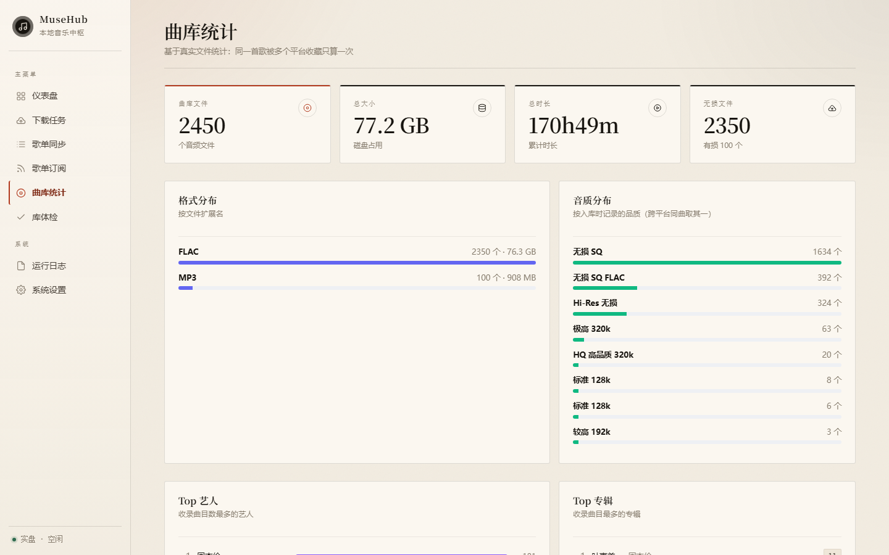
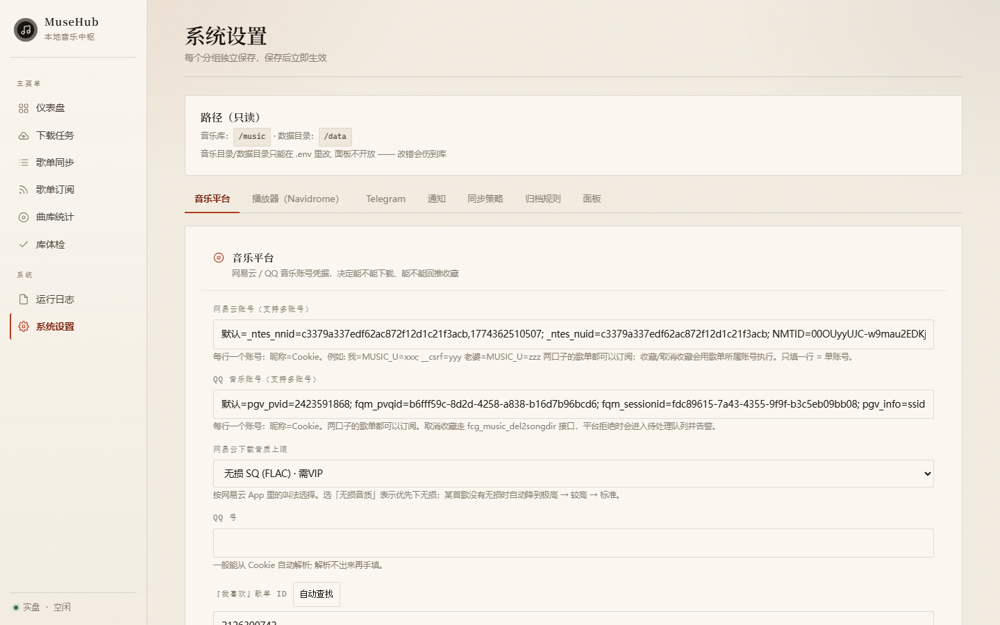

# MuseHub

<p align="center">
  
</p>

<p align="center">
  订阅平台歌单 → 自动下载归档 → 镜像到 Navidrome，<b>平台 / 文件 / 播放器 / 收藏 四方一致</b>。
</p>

一个单进程、极简依赖（进程内 SQLite）的 Python 服务。它把"下载机器人"该做但没做好的事做完：
**歌单订阅、音质回退、标签封面歌词、播放器镜像、收藏回推、库体检**，全部在一个面板里。

---

## 为什么会有这个项目

用下载机器人给音乐库"补歌"，问题往往不在下载本身，而在这之后：

| 常见状况 | 结果 |
|---|---|
| 只管下，不管标签 | 播放器里全是"未知艺术家"、没有封面、专辑被拆成一堆单曲 |
| 平台收藏和本地库各说各话 | 手机上取消收藏，本地文件还在；本地删了文件，平台上还留着 |
| 播放器看不到平台歌单 | 想听"我喜欢的音乐"，还得先在播放器里手动建一遍歌单 |
| 机器人被网络超时拖死 | 点按钮没反应，进程还活着，日志也没报错 |

MuseHub 就是为了把这四件事一次解决而写的。

## 亮点

- **粘贴链接就订阅** —— 歌单 / 专辑 / 榜单都认，支持一个平台多个账号
- **下载即归档** —— 命名模板、标签、封面、内嵌歌词、`.lrc` 一次做完，不脏你的库
- **播放器镜像** —— 平台歌单自动变成 Navidrome 歌单，增删跟随；可改名、可按账号分发
- **收藏双向同步** —— 本地删了自动回平台取消收藏，平台加了自动跟着下
- **库体检 + 元数据刮削** —— 缺封面/缺歌词/重复文件/缺年份，一键补齐，且**只补空缺不覆盖**
- **每一步都可查** —— 实时进度、下载记录、失败原因、可筛选日志

### 1. 订阅：粘贴一个链接

歌单、专辑、榜单链接直接粘进输入框，自动识别平台与类型。多个账号时按"昵称=Cookie"配置，
不同账号的歌单可以各自订阅、各自下载、各自镜像。

<p align="center">
  
</p>

### 2. 下载：看得见进度，失败有原因

实时队列、今日成败、7 天趋势、平台分布。失败会写明原因（无音源 / 版权限制 / Cookie 失效），
支持一键重试全部失败；音质按"无损 → 极高 → 较高 → 标准"自动回退。

<p align="center">
  
</p>

### 3. 同步：平台与本地每轮 diff

每个订阅歌单都有下载进度条和同步时间。平台上加了歌 → 下一轮自动下；
平台上删了、且没有别的歌单引用 → 按策略处理本地文件（默认只删自己下的，且先进回收站）。

<p align="center">
  
</p>

### 4. 播放器镜像：平台歌单直接出现在 Navidrome

用 path 索引把本地文件映射成 Navidrome 的歌曲 ID，按歌单内容做增量镜像（不重建歌单，ID 不变）。
歌单可以改显示名；也可以指定镜像给哪个播放器账号——Navidrome 的私有歌单只有创建者可见，
于是"不同用户看不同歌单"就成了。

### 5. 库体检：把烂数据收拾干净

- **缺封面 / 缺歌词**：按播放器实际能看到的效果判定，一键补齐
- **重复文件**：同名同歌手多份文件，按音质择优保留
- **元数据缺失**：按库里记录的平台 ID **精确**补年份/音轨号/专辑/封面，不做"标题+艺人"搜索匹配，
  所以不会把现场版配成录音室版

<p align="center">
  
</p>

### 6. 统计与日志：出问题能自己查

曲库按格式/音质/年代/歌手分布；日志支持按级别、来源、关键词组合筛选，同步和配置变更都留痕。

<table>
<tr>
<td width="50%"></td>
<td width="50%"></td>
</tr>
<tr>
<td></td>
<td></td>
</tr>
</table>

---

## 快速开始

Docker（推荐，NAS / 服务器）：

```bash
git clone <this-repo> musehub && cd musehub
cp .env.example .env && vi .env          # 填 Cookie 与 Navidrome 地址
docker compose up -d                     # 面板 http://<host>:8890
```

把 `docker-compose.yml` 里的挂载源换成你的真实音乐目录（容器内固定 `/music`），
**Navidrome 也要挂同一个目录** —— 这是镜像能对上文件的前提。

本地直跑：

```bash
python -m venv .venv
.venv\Scripts\pip install -r requirements.txt    # Windows；Linux/macOS 用 .venv/bin/pip
cp .env.example .env
.venv\Scripts\python -m app serve
```

上线检查四步（CLI 与面板等价）：

```bash
python -m app doctor      # 配置体检
python -m app selftest    # 平台连通性：搜索 / 音源 / Navidrome
python -m app sync --dry  # 试运行，看它"将要"做什么
python -m app sync        # 确认无误再真跑
```

凭据怎么拿、三种部署方式、常见问题，见 [`docs/部署指南.md`](docs/部署指南.md)。

## 四个关键设计

**以文件系统为事实源。** 平台歌单、本地文件、播放器三方之间，本地文件是唯一真相：
平台 → 本地靠每轮 diff，本地 → 平台靠扫描发现"缺失"，本地 → 播放器靠 path 索引镜像。
任何一边的误操作都会被下一轮纠正，不需要"丢了就永远丢了"的消息队列。

**空值不覆盖已有值。** 平台列表接口经常不给年份、音轨号、专辑名。所有同步 / 导入路径
都遵守"空值不覆盖"——否则一次同步就能把刮削或人工修好的元数据冲干净。

**删除有硬边界。** 满足全部条件才动手：`delete_policy != never`、`managed=1`（本程序下载的）、
没有任何已订阅歌单引用、同路径没有其他 active 记录、不在试运行。任一不满足只记日志。

**收藏没有特判分支。** 网易云和 QQ 的"喜欢"机制完全不同，但都能归结为"『我喜欢』这个歌单的成员关系"，
于是平台侧只需 4 个原语：`playlist / add_tracks / remove_tracks / source`。

更多实现细节见 [`docs/ARCHITECTURE.md`](docs/ARCHITECTURE.md)。

## 配置

面板「系统设置」改，保存即热生效（不用重启）；也支持 `.env`。

| 项 | 说明 |
|---|---|
| `NETEASE_ACCOUNTS` / `QQ_ACCOUNTS` | 每行 `昵称=Cookie`，支持多账号；只填一行等于单账号 |
| `NAVIDROME_URL` / `USERNAME` / `PASSWORD` | 播放器镜像目标；不填则只下载整理，不动播放器 |
| `MUSIC_DIR` | 音乐库根目录（容器内固定 `/music`） |
| `SYNC_INTERVAL_MINUTES` | 同步周期，默认 60 |
| `DELETE_POLICY` | `never` / `managed_only` / `mirror`，默认 `managed_only` |
| `DRY_RUN` | `1` 时只记录不执行，首次上线建议先开 |
| `SCRAPE_WORKERS` | 元数据刮削并发数，默认 4（1~8，被限流就调小） |
| `TELEGRAM_TOKEN` / `ADMIN_IDS` | 可选，机器人 |

## 已知边界

- **流派补不了**：网易云 / QQ / 酷狗 / 酷我的接口都不返回 genre 字段，这是数据源限制
- **QQ 部分曲目无音源**：数字专辑需单独购买、版权下架，接口返回 `104003`，绿钻也拿不到
- **本地老文件没有平台 ID**：`provider=local` 的曲目无法自动匹配元数据，需人工
- **网易云部分专辑没有发行日期**：多见于日文盘，`publishTime` 为空
- **QQ 收藏回推是"尽力而为"**：旧版 songdir 接口对部分账号不可用，失败会进人工队列

## 开发

```bash
.venv/Scripts/python -m unittest discover -s tests -q   # 101 个用例
.venv/Scripts/python scripts/check_js.py                # 前端语法自检
.venv/Scripts/python scripts/audit.py --base http://<host>:8890 --cookie mh_key=xxx
                                                        # 前端巡检：JS 报错 / 失败请求 / 未绑定事件的按钮
.venv/Scripts/python scripts/shot.py --url ... --out ... # 带登录态截图
```

测试全部离线：`app/providers/mock.py` 起一个真实的本地 HTTP 服务吐音频，
下载、归档、镜像整条链路都能在 CI 里跑通，不碰真实平台。

## 文档

- [`docs/ARCHITECTURE.md`](docs/ARCHITECTURE.md) — 模块图、同步周期、数据一致性
- [`docs/部署指南.md`](docs/部署指南.md) — 三种部署方式、上线检查单、常见问题
- [`docs/对比TGmusicBot.md`](docs/对比TGmusicBot.md) — 为什么要自己写一个
